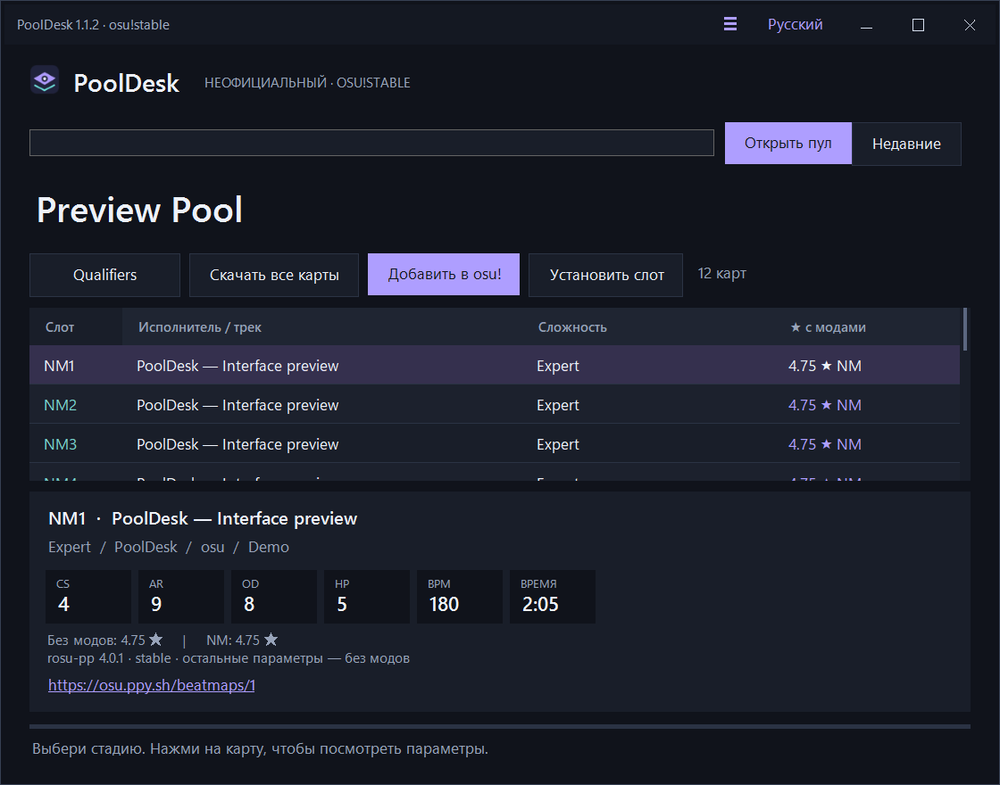
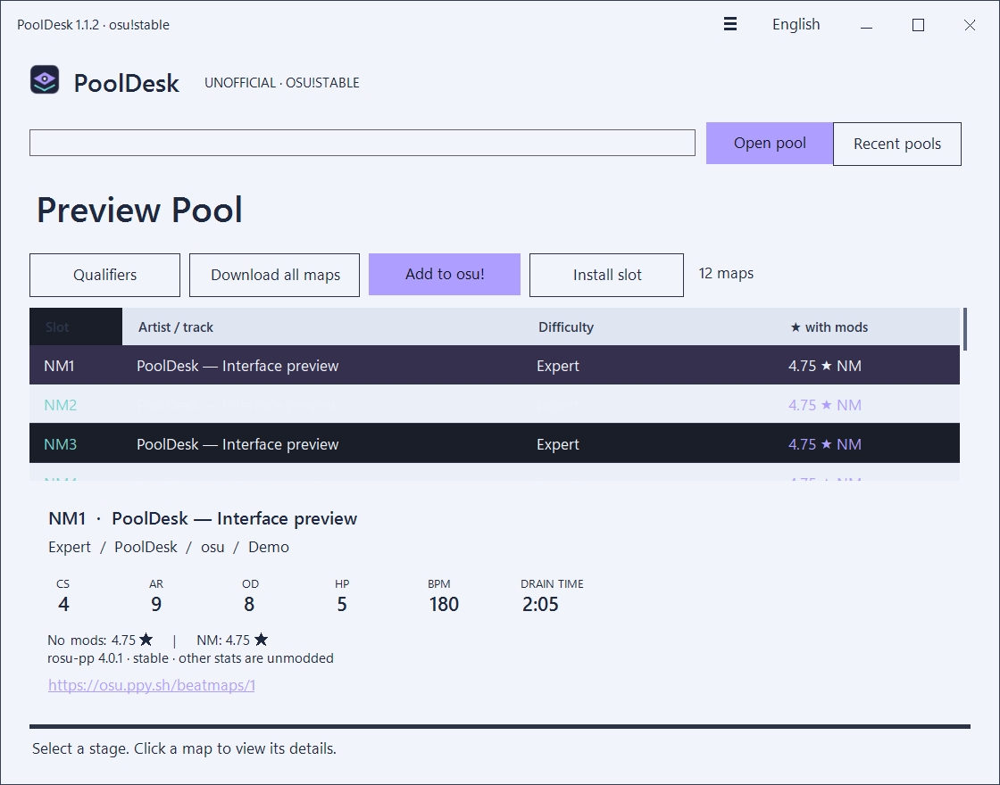
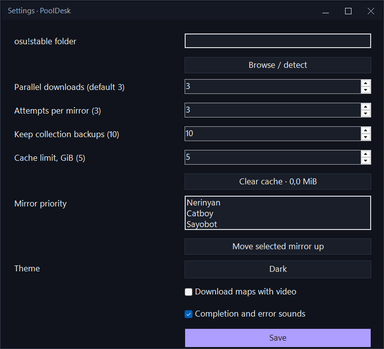
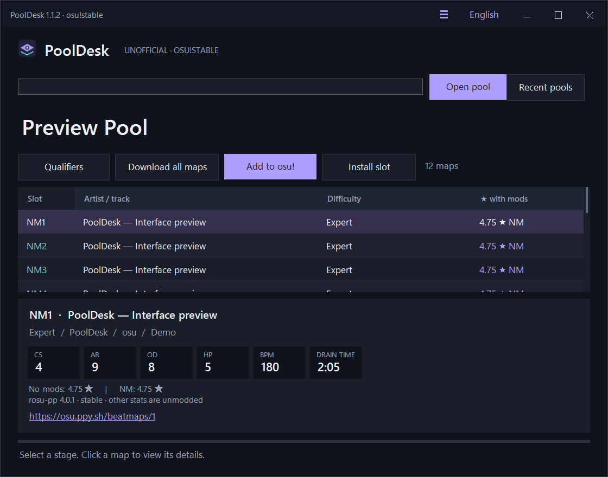

# PoolDesk

**Простая установка маппулов и коллекций для osu!stable.**  
**An easy way to install mappools and collections in osu!stable.**

[Русский](#русский) · [English](#english)

<p align="center">
  
</p>

---

## Русский

PoolDesk — небольшая программа для Windows, которая скачивает карты и устанавливает коллекции в osu!stable по ссылке из osu!Collector. Вставь ссылку, выбери стадию турнира и установи нужный пул без ручного поиска каждой карты.

### Возможности

- Загрузка турниров и коллекций по HTTPS-ссылкам osu!Collector.
- Выбор стадии турнира и скачивание наборов карт.
- Установка выбранной стадии в osu!stable с необязательным созданием коллекции.
- Старрейт с модами слота по умолчанию: например, HR1 → HR, DT1 → DT.
- Сравнение старрейта без модов и с модами по нажатию на карту.
- Просмотр CS, AR, OD, HP, BPM, игрового времени и ссылки на карту.
- Предупреждения об отсутствующих картах со стадией, слотом и ссылкой, если известен ID.
- Русский и английский интерфейс с сохранением выбранного языка.
- Тёмное оформление окна и спокойный интерфейс без декоративных анимаций.

### Скриншоты

<p align="center">
  
</p>

<p align="center">
  
  
</p>

### Установка и запуск

1. Открой раздел **Releases** этого репозитория.
2. Скачай архив `PoolDesk-Windows-*.zip` последнего релиза из раздела **Assets**.
3. Распакуй архив полностью.
4. Запусти **PoolDesk.exe**. Рядом должны оставаться `PoolDesk.exe.config` и `rosu_pp_ffi.dll`.
5. Для смены языка нажми **RU / EN** в верхней панели окна. Выбор запоминается автоматически.

**Требования:** Windows 10/11 x64, .NET Framework 4.8 и Microsoft Visual C++ v14 Runtime x64. Python и Node.js не нужны.

Если калькулятор сообщает об ошибке загрузки DLL, проверь, что `rosu_pp_ffi.dll` лежит рядом с EXE и что установлен [официальный пакет Microsoft](https://aka.ms/vc14/vc_redist.x64.exe).

### Как установить пул

1. Вставь ссылку на турнир или коллекцию osu!Collector и нажми **Открыть пул**.
2. Выбери стадию. Расчёт звёзд начнётся в фоне.
3. Нажми **Добавить в osu!**.
4. При необходимости оставь галочку **Создать коллекцию в osu!** и задай название.
5. Закрой osu!stable, нажми **Установить** и выбери папку с `osu!.exe`.
6. После завершения открой выбор песни в игре. Если карты не появились, нажми **F5**.

**Скачать все карты** скачивает наборы всех стадий в выбранную папку. **Добавить в osu!** устанавливает только выбранную стадию. Скачиваются целые наборы `.osz`, но в коллекцию записываются хеши только нужных сложностей.

Существующие коллекции сохраняются. Коллекция с тем же именем дополняется без повторных хешей. Перед заменой существующего `collection.db` создаётся резервная `.bak`-копия рядом с ним.

### Как считаются звёзды

Используются **rosu-pp 4.0.1** и **rosu-pp-ffi 0.1.3** в режиме **stable**. Оба значения — NM и с модами — рассчитываются локально по одному файлу `.osu`, а не через приблизительный множитель.

Поддерживаются NM, HD, HR, DT, NC, HT, EZ, FL, NF, SD, PF, SO и совместимые сочетания. У FM и TB нет заранее известного набора модов: для них показан **NM*** с пояснением. Для обычных коллекций без слотов также используется NM. Неизвестные или противоречивые моды не угадываются.

Звёзды могут отличаться от osu!Collector или другой версии игры, если там используется иной алгоритм. CS, AR, OD, HP, BPM и длительность остаются исходными параметрами **без модов**. Прочерк означает, что значение неизвестно, а не равно нулю.

### Данные и ограничения

- Поддерживается **osu!stable**. Установка коллекций в osu!lazer не реализована.
- Для получения пула, файлов карт и первого расчёта нужен интернет. Доступность внешних сервисов не контролируется проектом.
- Метаданные поступают из osu!Collector, файлы сложностей для расчёта — с `osu.ppy.sh`, архивы наборов — через зеркала Nerinyan/Catboy.
- Проверяются ID сложности и MD5, если он есть в ответе osu!Collector. При несовпадении версии, ошибке загрузки или расчёта NM не выдаётся за модовый старрейт. Пояснение доступно в панели карты; для повтора переключи стадию.
- Ошибка отдельного набора или неизвестная карта не останавливает остальные загрузки. В коллекцию добавляются только успешно установленные сложности. Итог явно показывает ошибки и пропуски.
- Названия песен, сложностей и стадий сохраняются в исходном виде. Системное окно выбора папки и сообщения Windows могут использовать язык операционной системы.

### Файлы приложения

- Кеш и настройки находятся в `%LOCALAPPDATA%\PoolDesk`: данные для расчёта — в `DifficultyMaps`, загруженные для установки архивы — в `Maps`, выбранный язык — в `language.txt`.
- Журнал каждой операции сохраняется в `%LOCALAPPDATA%\PoolDesk\Logs`: источник, результат каждого набора, пропущенные ссылки и ошибки. Журналы могут содержать локальные пути — проверь их перед публичной отправкой.
- Успех и ошибки сопровождаются разными мягкими синтезированными сигналами.

### Сборка и проверка

Из корня исходников на Windows:

```powershell
powershell -File .\build.ps1
powershell -File .\test.ps1
```

Сборка создаёт `PoolDesk.exe`. Тестам нужен интернет при первом запуске; тестовые данные и рендеры сохраняются в `.test-cache`. Они не устанавливают карты в пользовательскую osu! и не меняют её `collection.db`.

### Структура проекта

| Файл | Назначение |
| --- | --- |
| `Window.cs` | Интерфейс |
| `DarkForm.cs` | Тёмная рамка окна |
| `Theme.cs` | Оформление |
| `Language.cs` | Переводы |
| `Pool.cs` | Работа с API и установка |
| `Ratings.cs`, `Native.cs` | Расчёт сложности (интеграция с rosu-pp) |
| `NoticeSound.cs` | Звуковые сигналы |
| `Tests21.cs`, `test.ps1` | Проверки |
| `build.ps1` | Сборка |

### Обратная связь

Если нашёл ошибку, создай **Issue** и укажи версию PoolDesk, версию Windows, ссылку на пул, шаги воспроизведения и текст ошибки.

### Неофициальный проект

**PoolDesk — независимый, неофициальный проект. Он не связан с ppy, не представляет компанию ppy и не является официальным, одобренным или спонсируемым продуктом ppy, osu! либо любого другого продукта или сервиса ppy.**

Проект также не является официальным клиентом osu!Collector и не связан с его разработчиками. Названия ppy, osu! и osu!Collector используются только для обозначения совместимости и источников данных.

### Об использовании ИИ

> Да, я понимаю, что этот проект полностью «свайбкоджен»: собственный код PoolDesk на 100% сгенерирован нейросетью по моим запросам. Мой вклад — идея, требования и обратная связь. Я не выдаю этот код за написанный мной вручную и не скрываю использование ИИ.

Это относится к собственному коду приложения, а не к сторонним библиотекам: например, калькулятор **rosu-pp** разработан его авторами и используется на условиях их лицензий. Проверки проводились, но AI-сгенерированный код всё равно может содержать ошибки; гарантии отсутствия багов нет.

### Лицензия и права

Собственный код предоставляется по лицензии MIT в пределах прав, которые могут быть предоставлены. Сторонние компоненты сохраняют свои лицензии — они находятся в `LICENSE-rosu-pp-ffi.txt` и папке `licenses`.

Лицензия программы не распространяется на музыку, карты, изображения, товарные знаки или содержимое внешних сервисов. Скачивай только материалы, на использование которых у тебя есть необходимые права, и соблюдай правила соответствующих сервисов. Ни эта лицензия, ни пометка о неофициальности не гарантируют отсутствия юридических претензий.

---

## English

PoolDesk is a small Windows application that downloads beatmaps and installs collections in osu!stable from an osu!Collector link. Paste a link, select a tournament stage, and install the mappool without searching for every map by hand.

### Features

- Load tournaments and collections from osu!Collector HTTPS links.
- Select tournament stages and download beatmapsets.
- Install a selected stage in osu!stable and optionally create a collection.
- Show star ratings with slot mods by default, such as HR1 → HR and DT1 → DT.
- Compare unmodded and modded star ratings by clicking a map.
- Inspect CS, AR, OD, HP, BPM, drain time, and the map link.
- Show unresolved-map warnings with the stage, slot, and link when the ID is known.
- Switch between Russian and English, with the language preference saved.
- Dark window styling and a quiet UI without decorative animations.

### Screenshots

<p align="center">
  
</p>

<p align="center">
  
  
</p>

### Installation and launch

1. Open this repository's **Releases** page.
2. Download the latest `PoolDesk-Windows-*.zip` archive under **Assets**.
3. Extract the entire archive.
4. Run **PoolDesk.exe**, keeping `PoolDesk.exe.config` and `rosu_pp_ffi.dll` beside it.
5. Click **RU / EN** in the title bar to switch languages. Your choice is saved automatically.

**Requirements:** Windows 10/11 x64, .NET Framework 4.8, and Microsoft Visual C++ v14 Runtime x64. Python and Node.js are not required.

If the calculator reports a DLL loading error, check that `rosu_pp_ffi.dll` is beside the executable and that the [official Microsoft runtime](https://aka.ms/vc14/vc_redist.x64.exe) is installed.

### Installing a mappool

1. Paste an osu!Collector tournament or collection link and click **Open pool**.
2. Select a stage. Star ratings will be calculated in the background.
3. Click **Add to osu!**.
4. Optionally keep **Create a collection in osu!** checked and enter a name.
5. Close osu!stable, click **Install**, and select the folder containing `osu!.exe`.
6. Open song selection in the game after installation. Press **F5** if the maps have not appeared.

**Download all maps** downloads beatmapsets from every stage to a selected folder. **Add to osu!** installs only the selected stage. Whole `.osz` beatmapsets are downloaded, but only the required difficulties' hashes are added to the collection.

Existing collections are preserved. A collection with the same name is extended without duplicate hashes. Before replacing an existing `collection.db`, a `.bak` backup is created beside it.

### Star ratings

PoolDesk uses **rosu-pp 4.0.1** through **rosu-pp-ffi 0.1.3**, configured for **stable**. Both NM and modded values are calculated locally from the same `.osu` file, rather than estimated with a multiplier.

Supported mods include NM, HD, HR, DT, NC, HT, EZ, FL, NF, SD, PF, SO, and compatible combinations. FM and TB do not specify a fixed mod combination, so they display **NM*** with an explanation. Collections without slots also use NM. Unknown or conflicting mods are not guessed.

Ratings may differ from osu!Collector or another game version if a different calculation algorithm is used. CS, AR, OD, HP, BPM, and drain time remain **unmodded**. A dash means the value is unknown, not zero.

### Data and limitations

- **osu!stable** is supported. Installing collections in osu!lazer is not implemented.
- Loading pools, downloading maps, and the first calculation require internet access. The project does not control external service availability.
- Metadata comes from osu!Collector, difficulty files come from `osu.ppy.sh`, and beatmapset archives are downloaded through the Nerinyan/Catboy mirrors.
- Difficulty IDs and available osu!Collector MD5 checksums are validated. Version mismatches, download failures, and calculation errors never cause NM to be presented as a modded rating. Click the map for details; switch stages to retry.
- An unresolved map or a failed beatmapset does not stop the remaining downloads. Only successfully installed difficulties are added to the collection. The result explicitly reports errors and skipped entries.
- Song, difficulty, and stage names retain their original text. The system folder picker and Windows-generated messages may use the operating system's language.

### Application files

- Cache and settings are stored in `%LOCALAPPDATA%\PoolDesk`: difficulty files in `DifficultyMaps`, installation archives in `Maps`, and the language preference in `language.txt`.
- Each operation writes a log to `%LOCALAPPDATA%\PoolDesk\Logs`, including its source, per-set results, skipped links, and errors. Logs may contain local paths — review them before sharing publicly.
- Success and errors are accompanied by distinct, soft synthesized tones.

### Build and test

From the source directory on Windows:

```powershell
powershell -File .\build.ps1
powershell -File .\test.ps1
```

The build creates `PoolDesk.exe`. Tests require internet access on the first run and save their data and renders in `.test-cache`. They do not install maps into the user's osu! installation or change its `collection.db`.

### Project structure

| File | Purpose |
| --- | --- |
| `Window.cs` | User interface |
| `DarkForm.cs` | Dark window frame |
| `Theme.cs` | Styling |
| `Language.cs` | Translations |
| `Pool.cs` | API access and installation logic |
| `Ratings.cs`, `Native.cs` | Difficulty calculation (rosu-pp integration) |
| `NoticeSound.cs` | Sound notifications |
| `Tests21.cs`, `test.ps1` | Tests |
| `build.ps1` | Build script |

### Feedback

To report a bug, open an **Issue** with the PoolDesk version, Windows version, pool link, reproduction steps, and error message.

### Unofficial project

**PoolDesk is an independent, unofficial project. It is not affiliated with ppy, does not represent ppy, and is not an official, endorsed, or sponsored product of ppy, osu!, or any other ppy product or service.**

It is also not an official osu!Collector client and is not affiliated with its developers. The names ppy, osu!, and osu!Collector are used only to identify compatibility and data sources.

### AI disclosure

> Yes, I understand that this project is entirely “vibe-coded”: 100% of PoolDesk's own application code was generated by AI from my prompts. My contribution is the idea, requirements, and feedback. I do not claim to have written the code manually, and I am not hiding the use of AI.

This applies to the application's own code, not to third-party libraries: for example, the **rosu-pp** calculator was developed by its respective authors and is used under their licenses. Checks have been performed, but AI-generated code can still contain mistakes; there is no guarantee that the program is bug-free.

### License and rights

The application's own code is offered under the MIT license to the extent rights can be granted. Third-party components retain their respective licenses, which are included in `LICENSE-rosu-pp-ffi.txt` and the `licenses` folder.

The application license does not cover music, beatmaps, images, trademarks, or external service content. Only download content you have the necessary rights to use, and comply with the relevant services' rules. Neither this license nor the unofficial-project disclaimer guarantees protection from legal claims.

---

## Third-party projects / Сторонние проекты

- [osu!Collector](https://osucollector.com/)
- [rosu-pp](https://github.com/MaxOhn/rosu-pp)
- [rosu-pp-ffi 0.1.3](https://github.com/MaxOhn/rosu-pp-ffi/releases/tag/0.1.3)

Bundled `rosu_pp_ffi.dll` SHA-256:  
`cd7e7bba27673f599554575ce06480e9f1c3822c61849f126fde449e9866cab4`


### 1.1.2: установка слота / slot installation

Выбор слота (например, NM2) собирает его карты из **всех стадий** открытого пула. Перед установкой можно изменить название общей коллекции. Пустое название не принимается; отмена закрывает окно без установки.

Selecting a slot (for example NM2) gathers its maps from **every stage** of the loaded pool. Edit the shared collection name before installing. Empty names are disabled; Cancel exits without installing.
